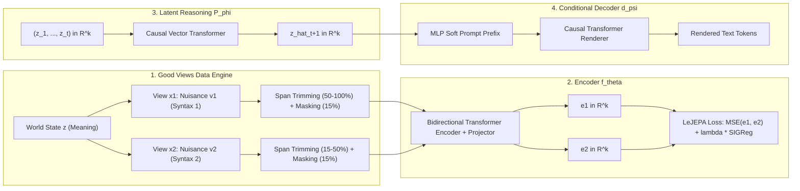

# Good-View Text JEPA System

A complete implementation of **Good-View Text JEPA (Joint-Embedding Predictive Architecture)** in pure PyTorch.

A Good-View Text JEPA separates **world-state representation learning** from **surface-level token generation**. While a standard LLM conflates reasoning and syntax at the token level, this framework:
1. First learns an invariant semantic space $\mathbb{R}^k$ using **Good Views** regularized by LeJEPA's **SIGReg** (Sketched Isotropic Gaussian Regularization).
2. Performs multi-step reasoning autoregressively in continuous vector space $\mathbb{R}^k$ using a causal **Latent Predictor** $P_\phi$.
3. Renders latent semantic states into natural language tokens using a lightweight causal **Conditional Text Decoder** $d_\psi$ conditioned on soft prompt prefixes.

---

## Architecture Overview



---

## Key Components

### 1. Good Views for Text & Augmentations
- **Modality Nuisance Isolation:** Multi-style views (standard, formal, casual, concise) share identical proposition state $z$ with independent syntax, vocabulary, and tone nuisances $v$.
- **Span Trimming:** Contiguous span sampling (50–100% for global views, 15–50% for local views) forces semantic matching without relying on document length artifacts.
- **Light Masking:** 15% random masking with `[MASK]`.

### 2. LeJEPA SIGReg Anti-Collapse Regularizer
Prevents representation collapse without negative samples, stop-gradients, or momentum encoders:
- Projects batch embeddings onto $P$ random 1D directions $V \in \mathbb{S}^{k-1}$.
- Evaluates the Empirical Characteristic Function (ECF) against target standard normal $\phi_0(t) = e^{-\frac{1}{2}t^2}$ via trapezoidal numerical quadrature across knots $t \in [-4\lambda_0, 4\lambda_0]$.
- Total JEPA Loss: $\mathcal{L}_{\text{total}} = \|e_1 - e_2\|^2 + \lambda \cdot \mathcal{L}_{\text{SIGReg}}([e_1; e_2])$.

### 3. Conditional Text Decoder (Vector-to-Text)
- Frozen encoder $f_\theta$.
- Input perturbation: $\tilde{e} = e + \epsilon$ where $\epsilon \sim \mathcal{N}(0, \sigma^2 I)$.
- Prefix Soft Prompt: Projected into $M$ virtual prompt tokens prepended to target token sequences.
- Causal next-token prediction with optional discrete style conditioning (e.g. `formal`, `casual`, `concise`).

### 4. Latent State-Transition Predictor (Latent Reasoning)
- Operates entirely in Platonic embedding space $\mathbb{R}^k$.
- Encodes sequential semantic chunks $(x^{(1)}, \dots, x^{(T)}) \rightarrow (z_1, \dots, z_T)$.
- Causal vector-space Transformer predicts future states $\hat{z}_{t+1}$ using regularized loss:
  $$\mathcal{L}_{\text{pred}} = \|\hat{z}_{t+1} - z_{t+1}\|^2 + \lambda \cdot \mathcal{L}_{\text{SIGReg}}(\hat{z})$$

---

## Directory Structure

```
goodViewLLM/
├── README.md                          # Documentation and mathematical overview
├── configs/
│   └── config.py                      # System, Model, and Training hyperparameters
├── src/
│   ├── tokenizer/
│   │   └── bpe_tokenizer.py          # Self-contained offline subword BPE tokenizer
│   ├── data/
│   │   ├── augmentations.py           # Span trimming (global/local) & token masking
│   │   ├── view_generator.py          # Synthetic proposition & multi-style view generator
│   │   ├── parallel_dataset.py        # Good-view pair dataset (invariance stage)
│   │   └── sequential_dataset.py      # Multi-step reasoning trace dataset (predictor stage)
│   ├── models/
│   │   ├── sigreg.py                  # Sketched Isotropic Gaussian Regularizer (SIGReg)
│   │   ├── encoder.py                 # Bidirectional Transformer encoder + projector -> R^k
│   │   ├── decoder.py                 # Causal decoder + soft prompt MLP projection
│   │   ├── predictor.py               # Causal Latent State Predictor P_phi
│   │   └── pipeline.py                # Full GoodViewTextJEPA pipeline
│   ├── training/
│   │   ├── trainer_utils.py           # AdamW, cosine schedule, checkpointing
│   │   ├── train_encoder.py           # Stage 1 training loop
│   │   ├── train_decoder.py           # Stage 2 training loop
│   │   └── train_predictor.py         # Stage 3 training loop
│   └── run_demo.py                    # Interactive demo CLI
└── tests/
    ├── test_tokenizer.py              # Tokenizer round-trip & serialization
    ├── test_augmentations.py          # Trimming, masking, and dataset tests
    ├── test_sigreg_and_encoder.py     # SIGReg anti-collapse and encoder tests
    ├── test_conditional_decoder.py    # Soft prompt projection & causal decoding tests
    ├── test_latent_predictor.py       # Vector-space transition & rollout tests
    └── test_end_to_end_pipeline.py    # Integration test for Stage 1 -> 2 -> 3
```

---

## Running the Tests

The system uses standard library `unittest` and runs completely offline with zero external network access:

```bash
/home/medlar/Projects/.venv/bin/python -m unittest discover -s tests -p "test_*.py" -v
```

All 20 unit and integration tests verify:
- Subword BPE encoding, decoding, and JSON persistence
- Contiguous span trimming ratios (50-100% global, 15-50% local)
- SIGReg non-collapse penalties and gradient flow
- Causal decoder soft-prompt conditioning and autoregressive generation
- Vector-space latent rollout without numerical instabilities
- End-to-end integration across all three training stages

---

## Running the Interactive Demo

Train and test the system locally on CPU:

```bash
# Train on CPU and demonstrate semantic invariance + latent reasoning
/home/medlar/Projects/.venv/bin/python src/run_demo.py --epochs 5 --samples 256 --steps 3

# Test custom reasoning prompt
/home/medlar/Projects/.venv/bin/python src/run_demo.py --prompt "Thermal energy is supplied to the liquid container." --steps 3
```

### Demo Output Highlights:
1. **Semantic Invariance in $\mathbb{R}^k$:**
   Demonstrates that different phrasings of the same concept (e.g. Standard vs Formal, Standard vs Casual) occupy neighboring coordinates in Platonic space $\mathbb{R}^k$, while distinct physical concepts (e.g. Water Freezing vs Speed of Light) are separated.
2. **Latent Reasoning Rollout:**
   Maps the prompt into $z_0$, rolls out future semantic states $(\hat{z}_1, \dots, \hat{z}_m)$ in $\mathbb{R}^k$ via $P_\phi$, and decodes each thought into fluent natural language via $d_\psi$.
